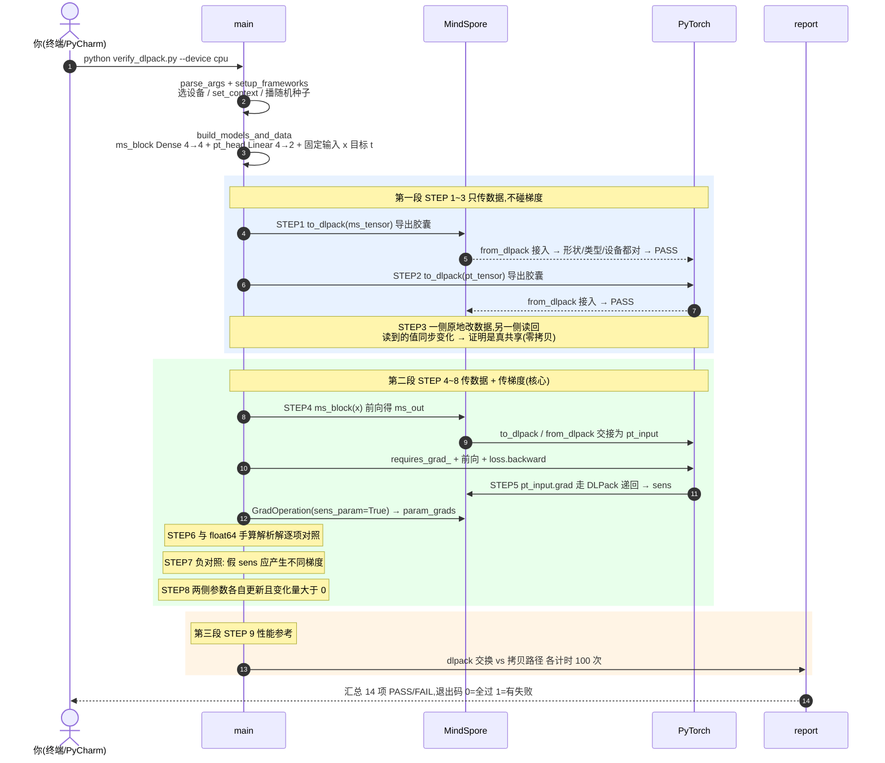
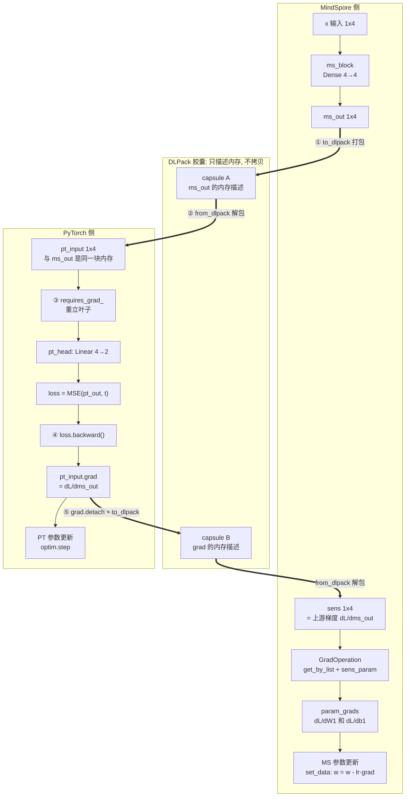
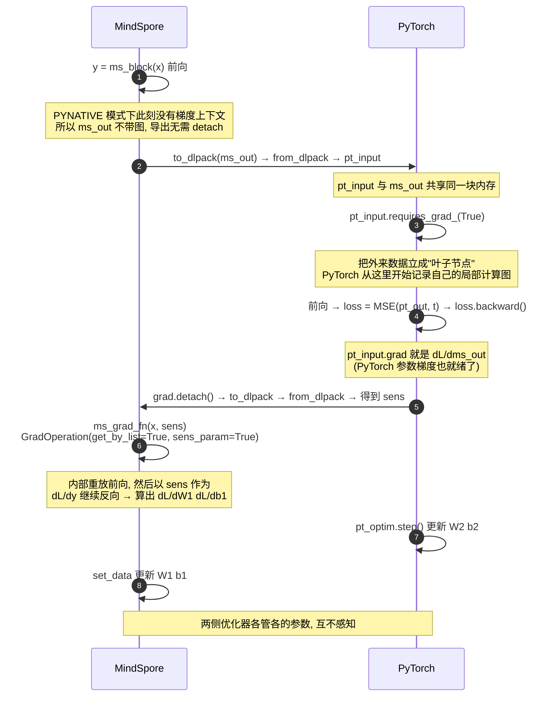
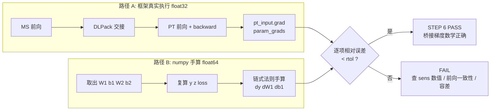

# verify_dlpack.py 代码解读(AI Infra 新人版)

> 配套脚本:`verify_dlpack.py`(同目录)。
> 本文用 Mermaid 图把整条验证链路讲清楚,建议用支持 Mermaid 的查看器阅读
> (GitHub / VSCode / PyCharm 2023+ 的 Markdown 预览均可直接渲染)。

---

## 0. 一句话看懂:这个脚本到底在证明什么

三句话,层层递进:

1. **能共享**:MindSpore 和 PyTorch 两个框架,能通过 DLPack "共用同一块内存"传
   Tensor,不发生数据拷贝(STEP 1~3)。
2. **能用**:数据传过去之后,PyTorch 那边把它当成自己的输入,正常训练、正常求梯度
   (STEP 4)。
3. **能桥接**:PyTorch 算出来的"边界梯度"能**手动递回** MindSpore,让两个框架的
   参数在一步训练里**一起被更新**(STEP 5~8)。

菜鸟类比(和方案讨论时一致):两个厨师(MindSpore/PyTorch)共用一口锅(同一块显存)。
普通做法要"倒锅"(拷贝数据);DLPack 是直接共用锅。但"菜谱"(计算图)不会跟着锅走,
所以"责任追溯"(求梯度)到了交接处就断了——我们要做的就是**手动把责任书递回去**
(sens 梯度桥接)。

---

## 1. 全局时序:运行一次脚本,发生了什么

对应 `main()` 的调用顺序。三个色块对应三段验证内容:



> 为什么分三段?**排查时是逐段收窄的**:第一段失败 = 环境问题(框架/DLPack 没通);
> 第二段失败 = 梯度桥接机制问题;第三段只是性能参考,失败不影响正确性结论。

---

## 2. 核心数据流:一次"传锅"和一次"递责任书"

STEP 4~8 在内存层面的真实走向。**实线粗箭头 = DLPack 交接点**(整个验证的价值所在):



记口诀:**①剪(重立叶子前先交接) ②传(两次 DLPack) ③立(requires_grad_) ④反向
(backward) ⑤递(grad 回送成 sens)**——正好对应图里 5 个编号动作。

---

## 3. 梯度桥接细讲:为什么"手动递梯度"能成立

### 3.1 时序(带步骤编号)



### 3.2 数学上发生了什么(为什么这是对的)

整个被验证的复合函数是一条**线性链**,手算完全可行:

```
y = x·W1ᵀ + b1        (MindSpore Dense,   形状 1x4)
z = y·W2ᵀ + b2        (PyTorch Linear,    形状 1x2)
L = mean((z - t)²)    (MSELoss,           标量)
```

链式法则展开:

| 量 | 公式 | 含义 |
|---|---|---|
| `dz` | `2(z - t) / numel = z - t` | loss 对输出的灵敏度 |
| `dy` | `dz · W2` | **dL/dms_out —— 就是 pt_input.grad,也是 sens** |
| `dW2, db2` | `dzᵀ·y, dz` | PyTorch 侧参数梯度(它自己算,自洽) |
| `dW1, db1` | `dyᵀ·x, dy` | **MindSpore 侧参数梯度 —— 桥接后 param_grads** |

**STEP 6 验证的本质**:左边的 `dy/dW1/db1` 是 PyTorch/MindSpore 框架自己算的
(float32、自动微分);右边是 numpy 在 float64 下手算的"标准答案"。两者相对误差
实测 ~1e-7,说明:

- `sens` 递进去的是**真实上游梯度**,不是默认的全 1;
- MindSpore 的反向机制收到外部 sens 后算出来的参数梯度**数学上正确**。

### 3.3 三个容易懵的点(新人必看)

| 疑问 | 答案 |
|---|---|
| 为什么 MS 侧导出不用 detach? | MindSpore 是"显式求梯度"设计:不在 GradOperation 上下文里,前向根本不记录计算图,`ms_out` 天然是无图的纯数据。而 **PyTorch 是默认记录**,所以 torch 侧任何带 `requires_grad` 的张量导出前必须 `.detach()`,否则直接报错。 |
| `sens_param=True` 不开会怎样? | MindSpore 反向默认假设"输出的梯度是全 1"(相当于 `sens=ones_like`)。那只在"网络输出直接就是 loss"时碰巧正确。我们场景里 loss 在 PyTorch 侧,真实梯度不是全 1——所以 STEP 7 专门做了负对照:**换上假 sens,梯度立刻不同**,证明桥接真的在传真梯度。 |
| 两次 DLPack 传的是同一个东西吗? | 不是。第一次传的是**前向激活值**(ms_out → pt_input);第二次传的是**梯度**(pt_input.grad → sens)。方向也不同:第一次 MS→PT,第二次 PT→MS。 |

---

## 4. 逐 STEP 速查表(干什么 / PASS 判据 / 调试看什么)

| 函数 | STEP | 干什么 | PASS 判据 | 调试观察 |
|---|---|---|---|---|
| `step1_2_basic_exchange` | 1~2 | 双向导出/导入 capsule | 形状、dtype 一致,设备正确 | `pt_from_ms.device` |
| `step3_zero_copy` | 3 | torch 侧 `fill_`/`add_` 原地改,MS 侧读回 | 读回值同步变化 → 真·零拷贝 | `after`(读回的 numpy 数组) |
| `step4_local_autograd` | 4 | 交接数据、重立叶子、PT 反向 | `pt_input.grad` 与参数梯度非空且有限 | `ctx["g"]` |
| `step5_gradient_bridge` | 5 | grad→DLPack→sens→GradOperation | `param_grads` 非空且有限 | `ctx["sens"]` |
| `step6_numeric_check` | 6 | float64 解析解逐项对照 | 每项 `rel_err < rtol`(默认 1e-3) | `dy` vs `ctx["g"]` |
| `step7_negative_control` | 7 | 用 ones_like 假 sens 反传 | 假梯度 ≠ 真梯度 | `diff_w` |
| `step8_update_params` | 8 | 两侧各自执行 SGD 更新 | 更新前后参数差 > 0 | `pt_moved / ms_moved` |
| `step9_benchmark` | 9 | 交换路径计时(100 次均值) | 无判据,仅参考 | µs 级即正常,毫秒级查隐式拷贝 |

## 5. 两个独立"计算路径"如何互相印证(STEP 6 图示)

验证强度的关键:不是"框架说对了",而是**两条完全独立的路径算同一个东西**:



## 6. 单步调试指南(PyCharm)

1. 打开 `verify_dlpack.py`,右键 **Debug**(默认参数即可,`--device auto` 会自动选 CPU);
2. 推荐断点与 Watch:

| 断点位置 | Watch 表达式 | 你会看到什么 |
|---|---|---|
| `step4_local_autograd` 末行 | `ctx["g"]` | 边界梯度 dL/dms_out(应接近 `dz·W2`) |
| `step5_gradient_bridge` 末行 | `ctx["sens"]`、`ctx["param_grads"]` | 递回来的 sens;MS 侧参数梯度 |
| `step6_numeric_check` 对照各行 | `dy`、`dW1_ref`、`rel_err(g, dy)` | 手算标准答案;误差应 ~1e-7 |
| `step7_negative_control` | `diff_w` | 假 sens 与真梯度的差(应远大于 0) |

3. 想跳过前面 STEP 直接调某一段?断点打在目标函数第一行,Debug 时用
   **Resume 跑到该断点**即可(前面 STEP 会正常执行并 PASS,约几秒)。

## 7. 与验收标准、910B 移植的关系

- **STEP ↔ 验收标准**的完整映射表在 `README.md` §3;本文补充一句总纲:
  第一段(STEP1~3)= 验收标准第一层"环境与交换";第二段(STEP4~8)= 第二层
  "梯度桥接正确性";STEP9 = 非功能需求里的性能可测量性。
- **移植到 910B 时,代码不用改**,只有三处行为会变(详见 README §4):
  1. `setup_frameworks`:`device_target` 变为 Ascend,且必须成功 `import torch_npu`
     (A2 上原生 torch DLPack 标记 Not Supported,补丁是唯一通道);
  2. 两次 DLPack 交接发生在 **NPU 显存**之间(零拷贝判定逻辑不变);
  3. 若数值偶发不一致 → 跨框架流同步问题,消费前加 `torch.npu.synchronize()`,
     容差可放宽 `--rtol 5e-3`。

---

### 附:一次成功运行的标准输出长相(节选)

```
  [PASS] STEP 5  MS 参数梯度非空 (sens_param=True)  -- fc.weight:(4, 4) | fc.bias:(4,)
  [PASS] STEP 6  pt_input.grad == 解析解 d(loss)/d(ms_out)   (rel_err=6.970e-08)
  [PASS] STEP 6  MS weight 梯度 == 解析解 d(loss)/dW1        (rel_err=1.423e-07)
  [PASS] STEP 7  假 sens 梯度 ≠ 真实桥接梯度   (max|ΔW|=1.515e+00)
合计: 14/14 PASS
```

看懂这三个数字,验证就算真的看懂了:
`rel_err≈1e-7` → 递的是真梯度;`ΔW≈1.5` → 假梯度骗不过负对照;`14/14` → 链路完整成立。
