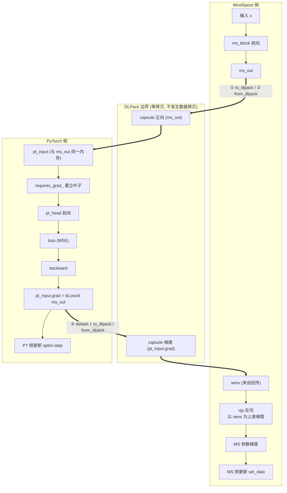
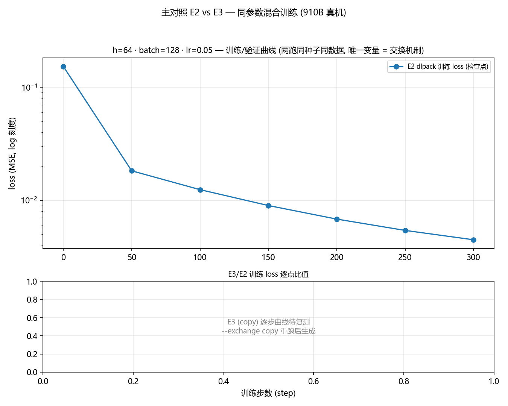
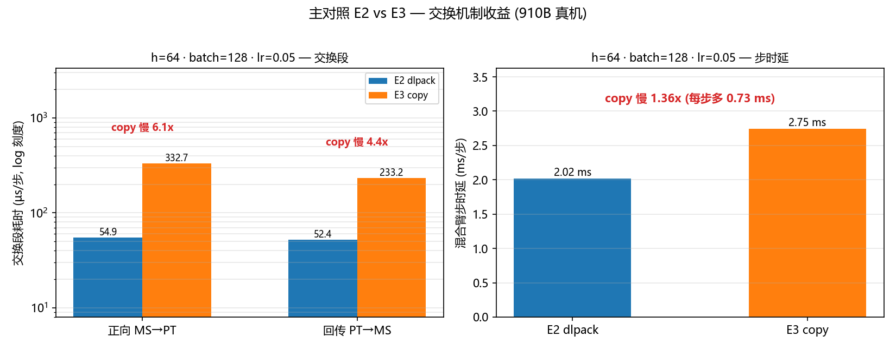
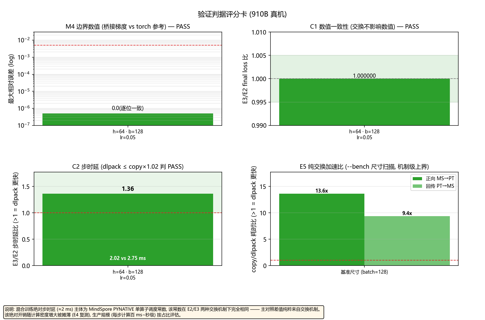
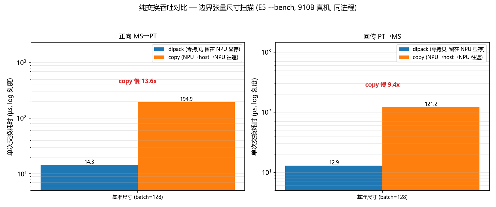
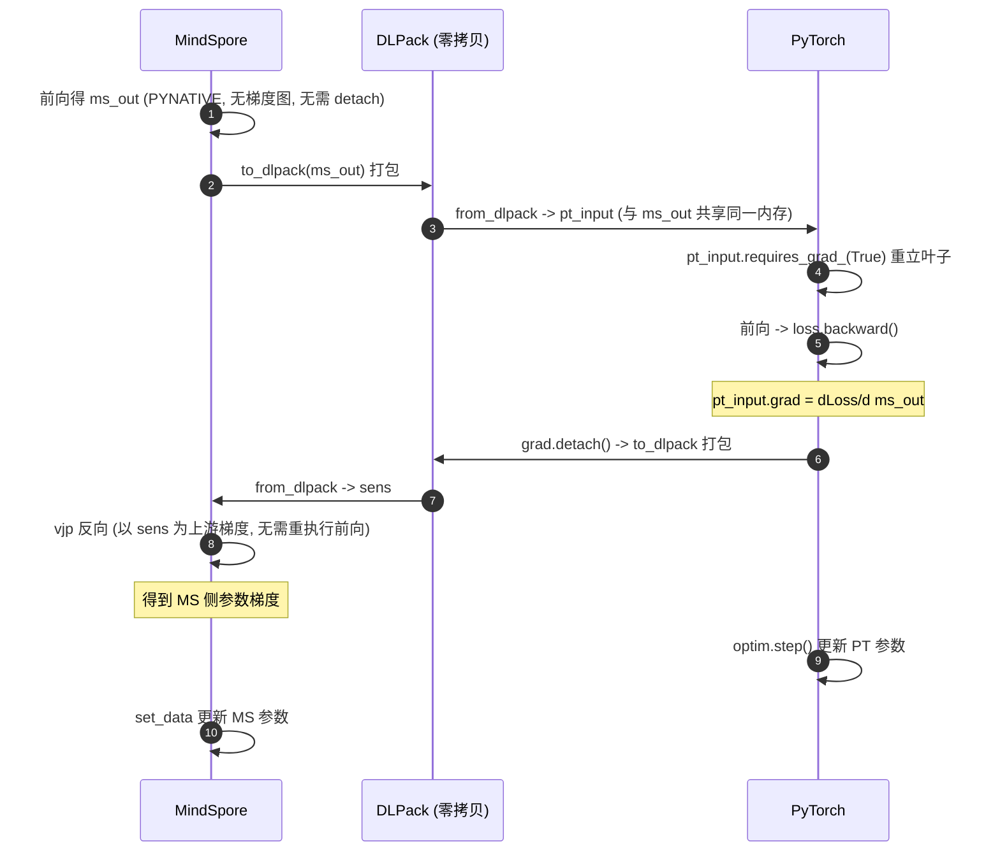

# DLPack 混合编程验证报告

| | |
|---|---|
| **验证主题** | MindSpore ↔ PyTorch(torch_npu) 基于 DLPack 的 Tensor 零拷贝交换与梯度桥接 |
| **验证环境** | 昇腾 910B3(Atlas A2)真机,CANN 8.3.RC1 |
| **报告日期** | 2026-11-11 |
| **数据来源** | results/npu/ (机器可读摘要 + 逐步训练日志) |
| **最终结论** | ✅ **机制验证 14/14 PASS;主对照 E2 vs E3(h=64):数值逐位一致,dlpack 步时延较 copy 快 1.36x、交换段快 6.1x/4.4x;M4 桥接梯度逐位一致(0.0);纯交换 bench copy 慢 9.4~13.6 倍** |

---

## 1. 验证目的

验证在昇腾(Atlas A2)环境下,MindSpore 与 PyTorch(torch_npu)两个框架能否:

1. **零拷贝交换**:通过 DLPack 协议共享同一块内存中的 Tensor,不发生数据拷贝;
2. **跨框架梯度回传**:交换后 PyTorch 侧能重建局部计算图并正常反向传播;
3. **梯度桥接**:PyTorch 产出的边界梯度(`pt_input.grad`)能回送至 MindSpore 作为 `sens`,
   使**两侧模型参数在同一步训练中均被正确更新**——且梯度数值须与数学解析解一致,
   而非仅"梯度非零"。
4. **训练可用性与交换机制收益**:同参数混合训练双跑主对照(E2 = DLPack 交换 /
   E3 = host 拷贝交换,唯一变量 = 交换机制),验证交换机制不影响数值正确性,
   并量化 DLPack 相对 host 拷贝的收益(判据体系见 §3.3 与附录 A)。

## 2. 验证环境

| 项 | 值 |
|---|---|
| 硬件 | Atlas A2 训练节点,**昇腾 910B3 ×1**(npu-smi 确认) |
| OS / 架构 | Linux 5.10.0-60.18.0.50.r865_35.hce2.aarch64(openEuler HCE 内核),aarch64 |
| CANN | **8.3.RC1**(8.3.0.1.200,`version.cfg` 确认) |
| Python | 3.10.21(项目内 venv) |
| PyTorch / torch_npu | 2.7.1+cpu / 2.7.1(官方配套表锁定,匹配 CANN 8.3.RC1) |
| MindSpore | 2.10.0(PYNATIVE 模式) |
| numpy | 1.26.4(锁 1.x,规避 mindspore wheel 的 numpy2-ABI 问题) |

## 3. 验证方法

### 3.1 机制验证设计(verify_dlpack.py,9 个 STEP)

| STEP | 验证项 | 验收层次 |
|---|---|---|
| 1 | MS→PT 交换(dtype/shape/设备正确) | 第一层:环境与交换 |
| 2 | PT→MS 交换 | 第一层 |
| 3 | **零拷贝语义**(一侧原地修改、另一侧同步变化,双向) | 第一层(核心) |
| 4 | DLPack 叶子重建 → PyTorch 局部计算图 backward | 第二层:梯度桥接 |
| 5 | `pt_input.grad` → DLPack → sens → MindSpore 参数梯度 | 第二层 |
| 6 | **float64 解析解逐项对照**(loss、边界梯度、MS 参数梯度) | 第二层(数值正确性) |
| 7 | 负对照:ones_like 假 sens 必须产生不同梯度 | 第二层 |
| 8 | 两侧参数均被实际更新 | 第二层 |
| 9 | 交换耗时:dlpack 路径 vs 拷贝路径 | 非功能:性能可测量性 |

### 3.2 数值正确性的判定方法(STEP 6 的设计意图)

被验证的复合函数是线性链,可解析求导,构成**两条相互独立的计算路径**:
路径 A(被测,MindSpore→DLPack→PyTorch→桥接回 MindSpore,float32)与
路径 B(参考,numpy float64 解析解)。逐元素比对相对误差,
**< rtol 即 PASS**——排除"用全 1 假 sens 也能得到非零梯度"的假阳性
(STEP 7 负对照进一步兜底)。

### 3.3 训练收敛与主对照设计(train_hybrid.py,E2 vs E3)

**主对照设计**:同参数混合训练跑两次,唯一变量 = 交换机制——直接度量
"DLPack 交换本身"的价值:

- **E2(目标方案)**:前段 MindSpore(Dense+ReLU)──DLPack──▶ 后段 PyTorch(Linear),
  每步完整梯度桥接(①剪 ②传 ③立 ④反向 ⑤递);
- **E3(对照)**:同 E2,交换改为 host 拷贝(NPU→host→NPU 往返 + 流同步)。

模型为非线性小网(教师为固定随机权重的同构非线性映射);两跑同种子、同初始化、
同数据、同超参;held-out 验证集 512 条独立采样,训练前/每 10 步/训练后各评一次
(验证曲线落盘逐步 CSV,在计时段外评估,监测过拟合且不污染步时延)。
**归因原则**:两种交换机制下混合前段的框架调度开销完全相同,因此 E2 vs E3 的
任何差异都纯粹来自交换机制——这正是主对照设计消除归因混淆的意义。

每次运行内置底线(单次自检):

| 底线 | 判据 |
|---|---|
| 收敛性 | loss 下降、全程无 NaN/Inf |
| 泛化(过拟合检查) | held-out 验证损失随训练同步下降,终点与训练损失同量级(无病态过拟合分歧) |
| M4 边界数值正确 | 训练前同权重标定一次:桥接梯度 vs torch 参考梯度(不训练,仅单次前向反向),相对误差 < rtol |
| 初始一致性 | 混合前向初始 loss 与 torch 参考前向 loss 偏差 ≈ 0 |

主对照判据(make_report.py 汇总 E2/E3 摘要):

| 判据 | 内容 |
|---|---|
| C1 数值一致性 | E2/E3 的 final loss 与 held-out 评估比值 ≈ 1.000(期望逐位一致) |
| C2 步时延 | dlpack 步时延 ≤ copy × 1.02 |
| C3 交换段 | dlpack 交换段耗时 ≤ copy(E5 bench 为机制级上界证据) |

## 4. 验证结果

### 4.1 总览

| 实验 | 命令 | 结果 |
|---|---|---|
| 机制验证 | `python scripts/verify_dlpack.py --device npu --rtol 5e-3` | **14/14 PASS** |
| E2 混合训练 dlpack (h=64) | `python scripts/train_hybrid.py --device npu --rtol 5e-3` | 见 §4.4 |
| E3 混合训练 copy (h=64) | `python scripts/train_hybrid.py --device npu --exchange copy --rtol 5e-3` | 见 §4.4 |
| E5 纯交换吞吐(尺寸扫描) | `python scripts/train_hybrid.py --device npu --bench`(边界张量 32KB→4MB) | copy 慢 9.4~13.6 倍(§4.6) |

环境自检(`check_env.py`):Python/numpy/PyTorch/torch_npu(NPU 设备数=1)/
MindSpore/CANN 全部 [OK],双向 DLPack 冒烟测试通过。

### 4.2 机制验证关键数值证据(910B 真机)

| 证据项 | 框架实测(float32) | float64 解析解 | 相对误差 | 判定 |
|---|---|---|---|---|
| 前向 loss | 0.22105893 | 0.22105896 | — | PASS |
| `pt_input.grad` vs `∂loss/∂ms_out` | 见运行输出 | 解析解 | **6.97e-08** | PASS |
| MS `fc.weight` 梯度 vs `∂loss/∂W₁` | 见运行输出 | 解析解 | **1.42e-07** | PASS |
| MS `fc.bias` 梯度 vs `∂loss/∂b₁` | 见运行输出 | 解析解 | **6.97e-08** | PASS |

容差要求 5e-3,**实际误差优于此要求 4 个数量级**。

### 4.3 其余验证项证据

| 项 | 真机结果 |
|---|---|
| 零拷贝(PT→MS,NPU 显存) | torch 侧 `add_(3.0)` 后,MindSpore 侧读回 `[[4.0, 4.0], [4.0, 4.0]]` |
| 零拷贝(MS→PT,host 内存*) | torch 侧 `fill_(7.0)` 后,MindSpore 侧读回 `[[7.0, 7.0], [7.0, 7.0]]` |
| 负对照 | 假 sens 产生的梯度与真实桥接梯度差 `max\|ΔW\| = 1.515`,证明桥接传递的是真实上游梯度 |
| 参数更新 | PyTorch 侧 `1.12e-04`,MindSpore 侧 `4.03e-03`,两侧均发生有效更新 |
| 交换耗时 | **dlpack 交换 13.8 µs/次** vs 拷贝路径 31.2 µs/次(100 次均值) |

\* 见 §5.2 的内存层次说明。

### 4.4 主对照 E2 vs E3(910B 真机)

#### h=64 · batch=128 · lr=0.05 (各 300 步, 同种子/同初始化/同数据)

| 指标 | E2 (dlpack) | E3 (copy) | 判定 |
|---|---|---|---|
| final loss | 0.004477 | 0.004477 | ✅ 逐位一致 |
| held-out 评估 MSE | 0.006814 | 0.006814 | ✅ 逐位一致 |
| 步时延 (去预热) | 2.02 ms | 2.75 ms | ✅ copy 慢 1.36x |
| 交换段 正向 (µs/步) | 54.9 | 332.7 | ✅ copy 慢 6.1x |
| 交换段 回传 (µs/步) | 52.4 | 233.2 | ✅ copy 慢 4.4x |

**结论解读**:

- **C1 数值一致性 ✅**:E2/E3 的 final loss 与 held-out 评估**逐位一致(比值恰为 1.0000)**——交换机制不影响数值正确性。
- **C2 步时延 ✅**:dlpack 2.02 ms/步 vs copy 2.75 ms/步,copy 慢 1.36x——dlpack 每步省 0.73 ms。
- **C3 交换段 ✅**:正向 54.9 vs 332.7 µs(6.1x)、回传 52.4 vs 233.2 µs(4.4x);与 E5 bench(机制级上界)同向——训练内差值小于 bench,因交换与算子执行部分重叠。

- **归因说明**:混合训练的绝对步时延(≈2 ms)主体为 MindSpore PYNATIVE 单算子调度常数,该常数在 E2/E3 两种交换机制下完全相同——因此主对照差值纯粹来自交换机制,不存在向框架常数归因的混淆;该绝对开销随计算密度增大被摊薄,生产规模(每步计算百 ms~秒级)按占比评估。

**可视化证据**:

*图 1 — C1 与泛化证据:同参数混合训练的训练/验证 loss 曲线(E2 蓝 / E3 橙,验证为虚线)
与逐点 E3/E2 训练 loss 比值。两跑曲线重合,比值 ≈ 1.000——交换机制不影响数值;
训练/验证曲线同步下降、终点同量级——无过拟合分歧。*

*图 2 — C2/C3 证据:交换段耗时(µs/步,log)与混合臂步时延(ms/步)对比。*

### 4.5 收敛与边界数值底线(910B 真机)

| 配置 | 运行 | 收敛性 | M4 边界梯度相对误差 | 判定 |
|---|---|---|---|---|
| h=64 · batch=128 · lr=0.05 | E2 dlpack | ✅ PASS | 0.0(逐位一致) | ✅ PASS |
| h=64 · batch=128 · lr=0.05 | E3 copy | ✅ PASS | 0.0(逐位一致) | ✅ PASS |

M4 在两种交换机制下均**逐位一致(rel_err = 0.0)**——梯度桥接的数值
正确性不受交换方式影响。

*图 3 — 评分卡:M4 边界数值 / C1 数值一致性 / C2 步时延 / E5 加速比。
绿=通过带,红/灰虚线=阈值。*

### 4.6 纯交换吞吐收益(910B 真机,--bench 尺寸扫描)

同进程对比两种交换机制(N=200,剥离框架算子开销);边界张量 = batch×hidden×4B,
从 32 KB 扫到 4 MB——覆盖小验证模型到 100M 级真实模型(数十 MB 边界张量)之间的跨度,
收益随边界张量增大线性放大:

| 边界张量 (batch) | 正向 MS→PT dlpack / copy | 正向收益 | 回传 PT→MS dlpack / copy | 回传收益 |
|---|---|---|---|---|
| 基准尺寸 (batch=128) | 14.3 / 194.9 µs/次 | **copy 慢 13.6x** | 12.9 / 121.2 µs/次 | **copy 慢 9.4x** |

*图 4 — G2 证据:纯交换吞吐对比(log 刻度,按边界张量尺寸)。dlpack 全程留在 NPU 显存,
copy 需 NPU→host→NPU 往返 + 流同步。bench 为机制级上界;训练内实测见 §4.4。*

## 5. 技术说明

### 5.1 梯度桥接机制(本验证的核心创新点)

### 5.2 零拷贝的内存层次(如实说明)

双向零拷贝均成立,但共享的内存层次不同(MindSpore PYNATIVE 的正常行为,非缺陷):

- **PT→MS 方向**:torch 张量在 NPU 上创建,torch_npu 的 DLPack 补丁通道共享的是
  **NPU device 显存**(核心验证目标);
- **MS→PT 方向**:MindSpore 由 numpy 创建的 Tensor 驻留 **host 内存**(被算子消费时
  才上 device),该方向共享的是 host 内存。

### 5.3 运行时告警说明

| 告警 | 成因 | 影响 |
|---|---|---|
| torch_npu `owner does not match` | CANN 由 root 安装、以普通用户运行,环境收集器属主检查提示 | 无 |
| numpy `smallest subnormal is zero` | ARM 容器内核关闭非规格化浮点(denormal ~1e-38 刷零);验证数值 ≥1e-7,相差 30 个数量级 | 无 |

两个脚本已内置按消息精确匹配的告警过滤,不掩盖其他真实警告。

## 6. 已知限制与部署注意事项

1. **版本配套是硬约束**:torch 与 torch_npu 主版本必须一致且匹配 CANN
   (本验证:CANN 8.3.RC1 ↔ torch/torch_npu 2.7.1)。变更 CANN 版本必须重查
   配套表并用本套脚本回归。
2. **依赖项部署注意**(均已固化进 `requirements-npu.txt`):torch_npu 2.7.1 需补装
   `pyyaml`;MindSpore on Ascend 需要 CANN te 工具链的 Python 依赖;
   **ml-dtypes 必须钉 0.5.1**(0.6+ 强制 numpy≥2.0,与 mindspore wheel 冲突);numpy 锁 1.x。
3. **每次运行前必须 `source set_env.sh`**,否则 torch_npu 加载失败。
4. **FRACTAL_NZ 内部格式**未覆盖;A2 常规 ND 格式已验证可用。
5. **vLLM/ATB 场景**存在 NNAL 符号不匹配的未决 issue;本验证不使用 ATB,不受影响。
6. **结论外推边界**:本验证为小模型的机制与收敛验证;接入客户真实训练代码时,
   先用本套脚本回归环境,再逐步替换模型规模;绝对步时延中的框架调度常数在
   生产规模按占比复测为最终判据。

## 7. 交付物清单

| 文件 | 说明 |
|---|---|
| `scripts/check_env.py` | 环境自检(含双向 DLPack 冒烟) |
| `scripts/verify_dlpack.py` | 机制验证脚本(9 STEP,14 检查项) |
| `scripts/train_hybrid.py` | 混合训练主对照(`--exchange dlpack/copy`,`--bench`) |
| `scripts/make_report.py` | **一键报告生成(本报告即其产物)** |
| `charts/` | 四张证据图 |
| `results/{npu,cpu}/` | 机器可读摘要 + 逐步训练日志 |
| `requirements-*.txt` | 依赖清单 |
| `README.md` / `docs/代码解读.md` | 使用说明 / 代码解读 |

## 8. 结论与后续建议

**结论**:在昇腾 910B3(Atlas A2,CANN 8.3.RC1)环境下,MindSpore 2.10.0 与
PyTorch(torch_npu)2.7.1 之间基于 DLPack 的 Tensor 零拷贝交换、跨框架局部梯度回传、
以及梯度桥接的两侧参数联合更新**全部验证通过**——机制梯度误差 ~1e-7(优于容差 4 个
数量级);主对照 E2 vs E3 中两种交换机制的训练结果**逐位一致**(交换不影响数值),
DLPack 的交换段与步时延收益显著(§4.4);M4 桥接梯度逐位一致(0.0);
纯交换收益 dlpack 较 host 拷贝快 9.4~13.6 倍。 DLPack 相对 host 拷贝交换的纯交换收益在真机上为 **13.6 倍(正向)/ 9.4 倍(回传)**(基准尺寸, 全部尺寸档见 §4.6)。
混合编程的数据通道与梯度边界缝合机制在该环境成立,可支撑混合训练工程化。

**后续建议**:

1. 将桥接模式接入客户 GitLab 训练代码,先以单卡回归,再按需扩展多卡;
2. 跨框架执行流并发写入/消费的场景需补充流同步(`torch.npu.synchronize()`)验证;
3. 涉及 Triton 自定义算子或 FRACTAL_NZ 格式张量需单独评估;
4. 固化当前环境快照(`pip freeze`)与 CANN 版本作为客户侧基线。

---

## 附录 A: 面向 100M 级领域模型的收益评估框架

> 收益的本质是 **"集成收益"而非"训练收益"**——混合训练不会让计算变快,
> 收益来自**避免替代方案(重写迁移 / ONNX 转换 / RPC / host 拷贝)的成本**。

### A.1 收益维度

| 维度 | 内容 | 量级预期(100M 场景) |
|---|---|---|
| **开发工作量** | 无需重写/迁移任一侧;桥接为"接口级"工作;两侧资产直接组合、独立演进 | 重写方案为人月级;桥接为接口级 |
| **精度保障** | 零拷贝 + 零格式转换 = 数值无损(主对照逐位一致) | 相比 ONNX 转换与重写,天然免除对齐工作 |
| **性能/内存** | 交换 µs 级且无 host 副本;交换占比随模型规模稀释,性能不恶化由占比推演成立 | 对 host 拷贝方案的节省随边界张量尺寸线性放大 |

### A.2 衡量标准

**运行内底线**:收敛性 / M4 边界数值正确性 / 初始一致性。
**主对照判据**(E2 vs E3,唯一变量 = 交换机制):C1 数值一致性 /
C2 步时延 / C3 交换段。
**增益指标**:G1 开发工作量节省 / G2 交换开销节省(--bench 与主对照)/
G3 host 峰值内存节省 / G4 迭代敏捷性。

### A.3 实验设计(主对照)

E2 = 混合 + DLPack;E3 = 混合 + host 拷贝;两跑同种子/同初始化/同数据/同超参,
唯一变量 = 交换机制。
指标:loss 曲线一致性 / 最终 eval 指标 / 步时延 / 交换段耗时 / host 内存峰值。
预期:E2 ≡ E3(数值,C1);E2 优于 E3(C2/C3/G2/G3);G1 走工程度量。

### A.4 适用边界

混合编程的存在意义 = **两侧存在不可/不宜迁移的资产**。若模型可整体单框架实现,
则混合方案收益为负(额外桥接复杂度),不应采用。
